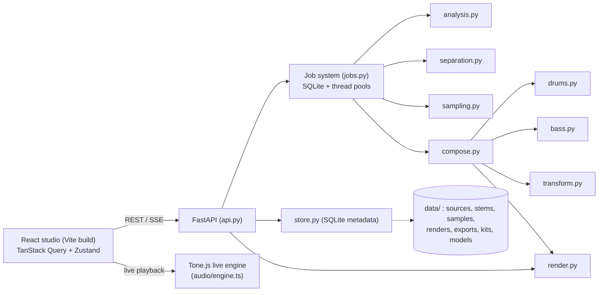

# Architecture

ChopLab AI is a local, single-user web app: a Python audio service plus a React studio in the browser.
Nothing leaves the machine. The backend binds to `127.0.0.1` only.

## Repository layout

| Path | Contents |
| --- | --- |
| `backend/src/choplab/` | The Python package (FastAPI service + audio engine) |
| `backend/tests/` | pytest suite (units, DSP, analysis, pipeline, API) |
| `frontend/src/api` | Typed REST client, TanStack Query hooks, shared types |
| `frontend/src/pages` | Home, Settings, and the project tabs (Source → Samples → Generate → Variations → Studio → Export) |
| `frontend/src/studio` | Arrangement studio: transport, timeline, pattern editors, mixer |
| `frontend/src/audio` | Live Tone.js engine, offline scheduling helpers, preview player |
| `frontend/src/lib` | Pure arrangement operations and music math (unit tested) |
| `frontend/src/stores` | Zustand studio store with undo/redo |
| `frontend/e2e` | Playwright end-to-end journey |
| `scripts/` | Setup, start and environment-check scripts |
| `data/` | Runtime data (git-ignored); override with `CHOPLAB_DATA` |

The spec suggested an `apps/` + `packages/` monorepo. Here each subsystem is a separate Python module in one
package and a separate frontend folder. That keeps the same boundaries with less packaging work.

## Backend modules

| Module | Responsibility |
| --- | --- |
| `core.py` | Constants (48 kHz, PPQ 480, 4/4), tick ↔ time math, data paths, key parsing |
| `audio_io.py` | Import validation, decoding to 48 kHz stereo float32 (ffmpeg via `imageio-ffmpeg` for MP3/AAC/M4A), atomic writes, waveform peaks |
| `store.py` | SQLite metadata store: projects, sources, analyses, samples, variations, exports, jobs (documents stored as JSON) |
| `jobs.py` | Persistent jobs with progress, cancel and retry. Separation runs in its own single-worker pool |
| `analysis.py` | Tempo with half/double candidates, beat grid, downbeats, key, onsets, sections, loudness |
| `separation.py` | Adapter registry: built-in HPSS (2 stems) and Demucs v4 via `audio-separator` (optional, 4 stems). Stems cached by content hash + model |
| `sampling.py` | Loop/chop candidate discovery with explainable weighted scores and MMR diversity |
| `transform.py` | Non-destructive time-stretch, pitch, reverse, filters and effects (pedalboard), cached by settings hash |
| `drums.py` | Four synthesized kits (written to WAV so sounds can be replaced) and a genre-aware pattern generator |
| `bass.py` | 808 synth/sampler and a key- and harmony-aware bassline generator that follows the kick |
| `compose.py` | Beat generator: sample choice, tempo, pitch, chops, drums, 808, arrangement, evaluation, de-duplication |
| `render.py` | Authoritative offline renderer: arrangement → tracks → mix → loudness-normalized, true-peak-limited master → WAV/MP3/stems |
| `schemas.py` | Pydantic validation of everything crossing the API boundary |
| `demo.py` | Deterministic synthetic demo song (92 BPM, A minor) for demos and tests |
| `api.py` | REST + SSE routes and the SPA host (`uv run choplab`) |

## Data model

The **arrangement** document is shared by the backend and the studio. It holds `bpm`, `bars`, `key`, `swing`, `kit`,
`sections`, `patterns` (sample-chop / drum / bass events in integer ticks), `tracks` (each with clips that reference
patterns, plus mixer and FX settings), `bass` (808 parameters) and `master`. All musical time is integer ticks
(PPQ 480), so the editor and renderer place events identically.

## Two playback paths

1. **Live engine** (`frontend/src/audio/engine.ts`, Tone.js). Low-latency playback while editing: sample chops,
   drum hits from the kit WAVs, a synthesized 808, per-track volume/pan/mute/solo/EQ/filter/reverb/delay and meters.
   Edits apply during playback.
2. **Render HQ** (`render.py`). The authoritative render. Previews and exports use this code path, so an export
   always matches the HQ preview. It adds what the live engine approximates or omits: loudness normalization
   (-14 LUFS target, -1 dBTP ceiling), tape wobble, vinyl noise and the sampled-808 mode.

## Jobs and progress

Analysis, separation, sample discovery, generation and export run as background jobs stored in SQLite. The UI
follows them over Server-Sent Events (`/api/jobs/{id}/events`) and can cancel or retry. Jobs left running when the
server stopped are marked as interrupted on restart.

## Persistence

The studio autosaves the arrangement (`PUT /api/projects/{id}/arrangement`) after a short debounce, and also on
Ctrl+S or before export. The server validates the document and returns it normalized. The store keeps it as the
baseline, so a refetch reloads the studio only when the server copy really differs.
